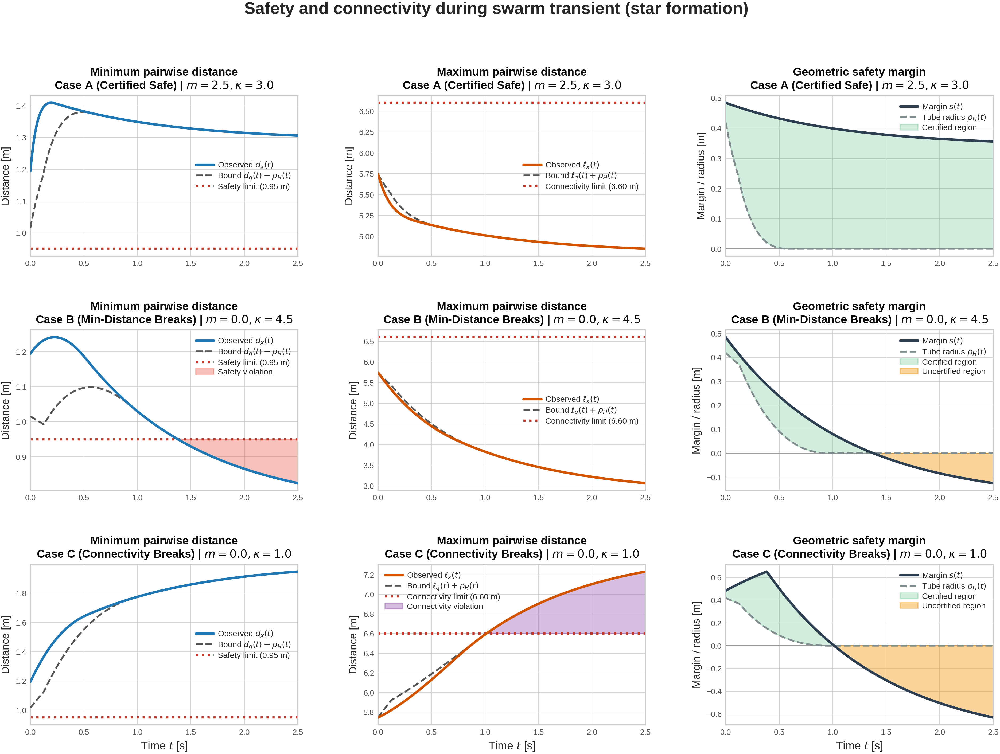

# Experiment 3: star maneuver safety and backbone connectivity

$q_i=r+a(t)p_i^0$, $a_\infty=1.65-0.25\kappa$, $a(t)=a_\infty+(1-a_\infty)e^{-0.9t}$, and $r(t)=(0.9t,1.1\sin(0.35t))$. The centered asymmetric star template, initial positions, $d_{safe}=0.95$, and $R_c=6.60$ are configured as in test.py.

| Case | $m$ | $\kappa$ | Geometry feasible | Min. separation | Max. backbone edge | Safe | H preserved | Active graph connected* | Certified |
|---|---:|---:|:---:|---:|---:|:---:|:---:|:---:|:---:|
| A | 2.5 | 3 | True | 1.194196 | 5.744381 | True | True | True | True |
| B | 0 | 4.5 | True | 0.752965 | 5.744381 | False | True | True | False |
| C | 0 | 1 | True | 1.194196 | 7.456241 | True | False | True | False |

*Connectivity is evaluated from the range-limited graph on the saved output grid. Case C loses complete-backbone links while Case B exhibits a minimum-distance breach.

